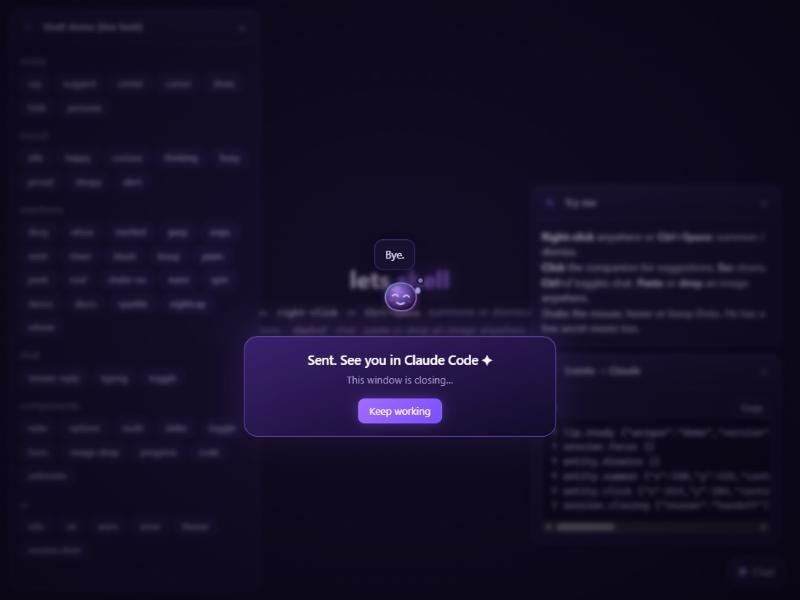
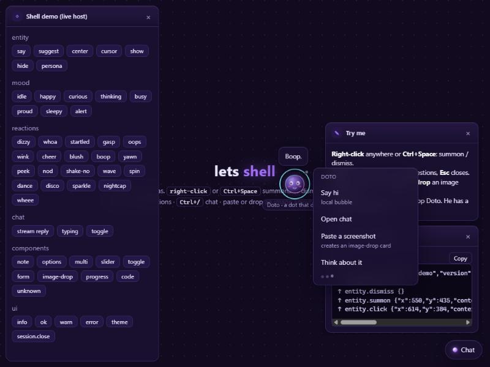

<p align="center">
  
</p>

<h1 align="center">lets</h1>

<p align="center"><b>Talk to Claude through windows, not just text.</b><br>
<code>/lets graph</code> opens a dark-violet board where you draw the thing you mean while you chat — and Doto, a small, bright dot that does, rolls up beside your cursor, suggests, learns you, and teaches himself new tricks.</p>

<p align="center">
  <a href="#install">Install</a> ·
  <a href="#using-it">Using it</a> ·
  <a href="#doto-the-companion">Doto</a> ·
  <a href="#default-uniques">Default uniques</a> ·
  <a href="#build-your-own-unique">Build one</a> ·
  <a href="docs/COMMUNITY.md">Community</a>
</p>

---

<p align="center">
  
  <br><sub>The graph board after a short back-and-forth: two nodes drawn by hand, the rest added by Claude (a data node, a decision, an annotation, a tree layout).</sub>
</p>

## What it is

`lets` is a Claude Code plugin with three layers:

| Layer | What it does |
|---|---|
| **Engine** (`engine/`) | A zero-dependency Node MCP server. Hosts windows on loopback, carries the protocol, keeps the companion's memory and your saved sessions, routes multi-task work to the cheapest trustworthy model, installs community mediums from git. |
| **Uniques** (separate repos) | The interactive mediums: static web apps that speak LIP (optionally with a native view for Claude Code's sidebar), each in its own repository. The engine installs the **default** ones from [defaults.json](defaults.json) on first use. Two ship today: [graph](https://github.com/offensiveadhd/lets-unique-graph), the board, and [den](https://github.com/offensiveadhd/lets-unique-den), Doto's home. |
| **Shell + SDK** (`sdk/`) | What every unique gets for free: the companion (Doto), chat panel, runtime components (sliders, options, forms, image paste…), toasts, theme. |

Everything crosses **LIP**, the *Lets Interaction Protocol* ([protocol/LIP.md](protocol/LIP.md)): typed JSON envelopes, up (human → Claude) and down (Claude → window). It is designed for mediums that do not exist yet; a unique for voice, AR or a haptic strip speaks the same envelope.

## Install

> The repo is **private while we test**. Anything that clones it needs GitHub credentials that can read it: log in with `gh auth login`, then run `gh auth setup-git`.

### Install with your agent

The easiest way: paste this into Claude Code and let it do the work. It follows [INSTALL.md](INSTALL.md), which is written for an agent.

```text
Install the `lets` plugin for Claude Code on this machine: clone https://github.com/offensiveadhd/lets (use `gh repo clone offensiveadhd/lets` — it is private, so make sure `gh auth status` is logged in and run `gh auth setup-git`), then run `node install.mjs` inside the clone and follow INSTALL.md in that repo. When done, tell me to restart Claude Code and show me `/lets graph`.
```

### Or one command, by hand

Needs Node 18+, the `claude` CLI on PATH, and git credentials that can read the repo (`gh auth setup-git`):

```bash
gh repo clone offensiveadhd/lets && cd lets && node install.mjs
```

The installer adds the `lets` marketplace from GitHub, installs the `lets` plugin at user scope, installs the default uniques (graph, den) into `~/.lets/uniques`, and installs a personal `/lets` alias. Restart the app or run `/reload-plugins` once, then both of these work in any session:

```
/lets:lets graph
/lets graph
```

Options:

| Flag | Does |
|---|---|
| `--local` | add the marketplace from this checkout instead of GitHub (edits are picked up on reinstall or update) |
| `--native` | also install the optional `lets-native` mod: `/lets`, `/lets-pane`, and the native panes of uniques that have one (Claude Code 2.1.287+) |
| `--no-skill` | skip the personal `/lets` alias |
| `--uninstall` | remove the plugins, the marketplace and the alias (your `~/.lets` stays) |

### By hand, inside Claude Code

```
/plugin marketplace add offensiveadhd/lets
/plugin install lets@lets
```

and `node engine/bin/lets.mjs install-skill` for the bare `/lets` alias. Update later with `claude plugin update lets@lets`. If something is off, `node engine/bin/lets.mjs doctor` prints what the engine sees, and [INSTALL.md](INSTALL.md) has the troubleshooting list.

## Using it

| You type | What happens |
|---|---|
| `/lets graph [intent]` | open the board, optionally with a first thing to work on |
| `/lets graph resume [id]` | open the board again with your last saved session (or the one with that id) |
| `/lets <unique> native [intent]` | open the unique as a pane inside Claude Code instead of a browser window (needs the lets-native mod; see [A pane instead of a window](#a-pane-instead-of-a-window-native)) |
| `/lets <unique> web [intent]` | open the browser window explicitly (what a bare `/lets <unique>` does when the unique has a page) |
| `/lets sessions` | list your saved sessions: when, which unique, label, summary |
| `/lets list` | the uniques this machine knows (and which are healthy) |
| `/lets store <query>` | search the community store; install only after you inspect and say yes |
| `/lets entity` | meet Doto: who he is, what he learned, which special skills he has |
| `/lets den` | open his home: see everything he learned about you and edit or forget any of it by pointing (see [How it learns](#how-it-learns)) |
| `/lets plan <work>` | split work into waves and pick a model per task (see [Model routing](#model-routing)) |

A session, start to finish:

1. `/lets graph plan the auth flow`: Claude opens the board in the app's browser pane, seeds a few nodes, and Doto greets you (*"Auth flow. I'll start with four steps."*).
2. Draw. Double-click a node to rename, drag from a node's edge to connect, right-click to summon or dismiss Doto, click Doto for suggestions. He rolls aside when you point at something, so he never covers it.
3. **Chat** and **Ask** get their answers in the window: Claude replies in the chat panel and points at the nodes it means.
4. Ask for more: *"open an image uploader"* gives you a paste/drop card; paste a screenshot and Claude reads the file. *"give me sliders for the weights"* gives you sliders, and every change reaches Claude.
5. Press **Send to Claude** when you want a proper review. Since 0.4.0 this is a handoff: the board is saved, the window closes itself (Doto waves goodbye), and Claude answers in the Claude Code chat with a reading of the flow and a few concrete proposals. It also gives the session a short label so you can find it again, and offers to reopen the board with its suggestions drawn in.
6. Come back whenever you like. Say `continue the <label> board` (use whatever the session was labelled), or run `/lets graph resume`. Claude opens a fresh window and loads the saved board into it. `resume` means the last session; if you ask for something specific, Claude picks the saved session that matches, and asks you one short question if two do.

<p align="center">
  
  <br><sub>The handoff: Doto waves, the card says where to find Claude, and the window closes itself.</sub>
</p>

Saved sessions live in `~/.lets/sessions/<unique>/<sessionId>.json` (board, label, summary, when). `/lets sessions` (or `node engine/bin/lets.mjs sessions` from a terminal) lists them. One window is one session: later sends and snapshots of the same window update the same file. If you would rather keep the window open after sending, set `"handoff": "stay"` in `~/.lets/config.json`; the default is `"close"`. If the browser refuses to close its own tab, the window keeps a hint and a **Keep working** button.

### A pane instead of a window (native)

New in 0.7.0. A unique can also open inside Claude Code itself, as a pane in its sidebar, with no browser. `/lets graph native plan the auth flow` opens the board that way and `/lets graph web …` opens the browser window; the word right after the unique's name picks the mode. Without it, a unique that has a page opens in the browser and one that only has a native view opens as a pane. Put `"mode": "native"` in `~/.lets/config.json` to make the pane the default for uniques that have both. graph 0.4.0 is the first unique with a native view; den and cocode are web-only for now.

The pane is drawn by the optional **lets-native** mod, so install it once: `node install.mjs --native`, or `/plugin install lets-native@lets` inside Claude Code (2.1.287+), then restart. If Claude opens a native window and no mod has polled the host yet, it says so in the chat and offers the web window instead.

The native graph is the board as one SVG picture, a list of its nodes with a button each, and inputs for the acts. Doto is a line at the top (his name and mood, his latest words beneath, his suggestions as buttons), the chat is a block under the view, and the components Claude composes (options, toggles, forms, a progress bar) are cards. The rest is the same as in the window: the same events and commands, the same `listen`, the same saved sessions. **Send to Claude** is still a handoff: the pane shows the farewell card and closes itself, and `/lets graph native resume` brings the board back.

The limits: there is no pointer, so Doto does not follow a cursor, `entity.move` does nothing and screenshots cannot be pasted; when Claude changes something the pane redraws at the next poll, about a second later; and a native window does not survive a new Claude Code session (saved sessions do). A native view is a script that the lets host runs in a vm context, which is isolation and not a security boundary, so install uniques with a native view only from authors you trust ([SECURITY.md](SECURITY.md)). The spec is [docs/NATIVE.md](docs/NATIVE.md).

## Doto, the companion

Doto is a dot that does. He is the smallest mark you can put on a board, and the one everything else gets drawn from. He is Claude's presence inside the window: a small round dot of light that rolls up beside your cursor on a gentle spring and rolls aside whenever he would cover what you point at. Click him for suggestions. He would rather do the next thing than talk about it, so he does, then tells you. He counts things, ends his lines on a dot, and does more than he says. He learns how you work and teaches himself special skills, and [den](#how-it-learns) is where you see and edit what he learned. The name is a default; it is yours to change.

<p align="center">
  
  <br><sub>Doto in the shell demo (<code>sdk/demo/</code>): his click menu, the mood buttons on the left, the event log on the right.</sub>
</p>

### How he talks

Short, verb first, and every line ends on a dot. Longer answers go to the chat panel, in Claude's normal voice.

| Moment | Doto says |
|---|---|
| he greets you | *Hi, I'm Doto. Point at something and let's do it.* |
| after an edit | *Added Retry and Backoff. Next?* |
| he asks | *Which branch is the happy path?* |
| you boop him | *Boop.* or *Again? Fine.* |
| five boops | *Five dots. You're keeping count too.* |
| a secret move | *Secret move found: **the dot bounce** (2/7).* |

Once in a while a catchphrase slips out: *Dot it.*, *Done-done.* or *Dot by dot.*

### Moods

Eight moods, set by Claude (`entity.mood`) or carried by a speech bubble:

| Mood | Meaning |
|---|---|
| `idle` | resting; a slow roll in place |
| `happy` | something landed; closed, smiling eyes |
| `curious` | he has a question; one eye bigger, mouth in an "o" |
| `thinking` | Claude is working on your request; a slow orbit around him |
| `busy` | lots landing; a fast orbit |
| `proud` | done; a hop and a shine |
| `sleepy` | you paused; heavy eyelids and little Z's |
| `alert` | look here; wide eyes and a pulsing aura |

### Expressions

On top of the moods, Doto reacts to what you do with short animations (half a second to two and a half). They run in your browser, cost zero tokens, never block your input, skip the spins when your system asks for reduced motion, and have cooldowns so Doto never nags.

| You do | Doto does |
|---|---|
| move the mouse very fast, or shake it | `dizzy`: spiral eyes, a wobble |
| zoom the wheel fast | `whoa`: big eyes, leans back |
| click a lot, quickly | `startled`: a little jump, a sweat drop |
| delete something (Delete or Backspace outside a text field) | `gasp` |
| undo (Ctrl+Z) | `oops` |
| rest the pointer on Doto | `blush` |
| click or tap Doto | `boop`: a squish and a heart |
| stop for a while | `yawn`, then `sleepy` |
| come back after being away | `peek`: looks toward your pointer |
| leave the window | `wave` |
| press **Send to Claude** | `cheer`, then a `wave` goodbye as the window closes |

Claude and uniques can play reactions too (`entity.react`): `nod`, `shake-no`, `wink` (the graph does this when you connect two nodes), `cheer`, `sparkle`. The full list and the details are in [docs/ENTITY.md](docs/ENTITY.md).

### Secret moves

Doto has a few moves he only makes when you find the trick. No spoilers, only places to poke:

- Double-click Doto.
- Type his name, d-o-t-o, while nothing is focused.
- The Konami code. You know it.
- Circle him with your pointer.
- Boop him five times in a row.
- Pick him up and drag him around.
- Visit after midnight.

Finding one is recorded in Doto's profile (`secrets` keeps the names you found), and he may say so. It happens once per secret per window, so it stays a surprise. In [den](#how-it-learns) the ones you found are lit; the rest stay a `?`, with no hint.

### How it learns

Three honest channels, all on disk, all in `~/.lets/entity`:

| Channel | File | What it holds |
|---|---|---|
| **Profile** | `profile.json` | aggregates the shell measures: pace, click rate, dwell, favourite screen regions, idle time, summons and picks, secrets found. Sent at most once a minute, never raw mouse moves. Fast movers get a quicker, quieter Doto; people who dismiss more than they pick get a less chatty one. |
| **Memory** | `memory.jsonl` | what Claude wrote down that it noticed ("prefers tree layouts"). The last few lines are in every brief. |
| **Special skills** | `skills/<name>.md` | small playbooks Claude writes for itself when it finds a reusable way to help ("screenshot → nodes → questions"). The index is listed on every open; a skill's body is read when its triggers match; it is reinforced or demoted by how it worked out. |

The persona (name, traits, likes) is in `persona.json` next to them. Nothing is inferred silently: if Doto "knows" something, there is a line, a field or a file that says so. Delete `~/.lets/entity` and Doto starts over.

**den is where you see all of it, and edit or forget what you point at.** Run `/lets den` and the persona (name, tagline, colour, the six traits as sliders, likes, dislikes, nicknames), the memory lines, the special skills, the secret moves you found and your interaction profile are laid out as Doto's home. Point at a line to forget it, drag a trait slider, click his name to rename him. The window updates at once and marks the line as waiting; Claude then applies the change with the `entity` tool, confirms it, and Doto says one line. An edit made in den reaches these files only through Claude. **Send to Claude** in den is a handoff for a memory review in the chat, and *continue* reopens den with the live state.

### See it, rename it, edit it

```
/lets den                     Doto's home: see and edit everything he learned, by pointing
/lets entity                  who Doto is, what he learned, which skills he has
/lets entity rename Spark     give him another name
/lets entity forget <skill>   drop a skill he taught himself
node engine/bin/lets.mjs entity     the same brief, from a terminal
```

Claude drives the same through the `entity` tool: besides `brief`, `learn`, `teach`, `reinforce` and `forget`, 0.6.0 adds `full` (the whole state), `set` (assign name, tagline, colour or traits directly), `unlearn` (remove likes, dislikes, nicknames or memory lines), `memory` (recent lines with their `ts`) and `reset` (name, tagline, colour and traits back to defaults; likes, memory and skills are kept). The cheat-sheet is [skills/lets/reference.md](skills/lets/reference.md).

## Listening vs away

While `/lets graph` runs, Claude stays in an attentive loop and the window shows a green dot: everything you do in the window (chat, Ask, Doto's menu, a pasted image) gets a reaction within seconds. When Claude is not in that loop the dot turns amber and the chat says *Doto is away*: your messages are kept and delivered with your next prompt in Claude Code.

**Send to Claude** does not depend on the loop. The engine saves the board and closes the window itself, listening or not. If Claude is listening it answers in the Claude Code chat right away; if it is away, the export waits and arrives with your next prompt, and Claude answers there.

In the terminal CLI you can also load the plugin as a channel (`claude --dangerously-load-development-channels plugin:lets@lets`), and window events wake Claude directly.

## Default uniques

The engine knows nothing about graphs. A unique is a repository with a manifest, a guide and a static UI; the engine serves it, gives it Doto and the protocol, and that is all.

[defaults.json](defaults.json) is the **approved list every installation gets**. Those uniques are installed from git into `~/.lets/uniques` the first time the engine runs or the first time you open one; `node engine/bin/lets.mjs defaults` does it by hand, and `LETS_NO_DEFAULTS=1` opts out. Today the list is exactly two entries:

| Unique | What you do with it | Repo | Default |
|---|---|---|---|
| `graph` | talk in diagrams: draw flows and ideas on a node/edge board while Claude and Doto read and edit the same graph | [lets-unique-graph](https://github.com/offensiveadhd/lets-unique-graph) | yes |
| `den` | see what Doto learned about you and edit or forget any of it by pointing: persona, traits, likes, nicknames, memory lines, special skills, the secret moves you found | [lets-unique-den](https://github.com/offensiveadhd/lets-unique-den) | yes |

Also available (not default):

| Unique | What you do with it | Repo | Install |
|---|---|---|---|
| `pulse` | a mood dial you talk through; the template unique, and the place to start your own | [lets-unique-template](https://github.com/offensiveadhd/lets-unique-template) | `/lets store pulse` |

Everything else comes from the community store, [lets-store](https://github.com/offensiveadhd/lets-store), where candidates grow.

New entries in `defaults.json` are **proposed by issue**, using the [unique proposal form](https://github.com/offensiveadhd/lets/issues/new?template=unique-proposal.yml), and a unique must be **store-verified** first. The path is written down in [docs/COMMUNITY.md](docs/COMMUNITY.md).

## Build your own unique

A unique is a folder:

```
my-unique/
  unique.json   # LIP manifest: name, entry, domains, capabilities, events, commands, permissions
  GUIDE.md      # how Claude should react to your events
  icon.svg
  ui/index.html # imports /sdk/lets-client.js and /sdk/lets-shell.js
  native/index.js # optional: a view for Claude Code's sidebar (see docs/NATIVE.md)
```

Start from the template repo **lets-unique-template**, run the host standalone while developing:

```bash
LETS_UNIQUES_DIRS=/path/to/parent node engine/bin/lets.mjs serve --open my-unique   # or put it in ./.lets/uniques/ or ~/.lets/uniques/
node engine/bin/lets.mjs validate ./my-unique
```

Publish by pushing to GitHub and adding an entry to a store (`lets-store`). Users install with `/lets store my-unique` → inspect → confirm. A web unique is static and sandboxed by CSP, and the host never runs it. If you also give it a native view (`native/index.js`, declared as `native.entry` in the manifest; the spec is [docs/NATIVE.md](docs/NATIVE.md)), that one script runs in a vm context inside the host, so people should install it only from an author they trust. See [docs/UNIQUES.md](docs/UNIQUES.md), and [docs/COMMUNITY.md](docs/COMMUNITY.md) for how a unique goes from idea to the store (and, if it earns it, to the defaults).

### Run on your machine

New in 0.7.0. When you press **Run** in a unique that holds a program (cocode is the example), the window asks the engine to run it, and the output streams back in milliseconds. The first time, the window shows a consent card, and nothing runs until you allow that unique on this machine. The code runs as you, in a throwaway job folder under `~/.lets/run/jobs/`, with a scrubbed environment, a 30 s limit and a 1 MB output cap. Python runs under an audit hook that blocks files outside the job folder, sockets and subprocesses; JavaScript and TypeScript run under Node's permission model, which blocks files outside the job folder and child processes but does not block the network. It is not a VM (CPU and memory are not capped), and other languages still go through Claude, which has a matching `run` tool. To turn the whole feature off, put `"runner": {"enabled": false}` in `~/.lets/config.json`. The details are in [docs/RUNNER.md](docs/RUNNER.md).

## Model routing

`/lets plan …` splits work into parallel waves and picks `haiku` / `sonnet` / `opus` per task from kind priors (format → haiku, architecture → opus …) and a ledger of past outcomes (`~/.lets/router/ledger.json`). Claude then spawns the waves with its Agent tool and reports back, so trust adjusts with evidence.

## Layout

```
.claude-plugin/   plugin + marketplace manifests
.mcp.json         registers the engine as MCP server "lets"
skills/lets/      the /lets skill (SKILL.md + reference.md)
hooks/            UserPromptSubmit hook: delivers window events with every prompt
engine/           host, bus, registry, entity, router, store, MCP server, and
                  src/native.mjs (the native window runtime: vm contexts, trees, shell)
mods/lets-native/ the optional Claude Code mod that draws native windows as panes
sdk/              lets-client.js (transport), lets-shell.js/.css (Doto, chat, components)
install.mjs       one-command installer (INSTALL.md is the agent-facing version)
defaults.json     uniques installed on first use (graph, den)
uniques/          bundled uniques (none; see uniques/README.md)
tests/fixtures/   a minimal unique the tests run against
protocol/         LIP.md + JSON schemas
docs/             architecture, authoring, native windows (NATIVE.md), entity, UI contract, community
tests/            node --test
.github/          issue forms, pull request template, CI
```

## Develop

```bash
npm test                                  # unit tests
node tests/mcp-smoke.mjs                  # full stdio ↔ host ↔ window round trip
node tests/hook-drain.mjs                 # the prompt hook against a live host
node engine/bin/lets.mjs serve --open graph --verbose     # standalone host, prints every event
node engine/bin/lets.mjs url graph                        # a window URL for the running host
node engine/bin/lets.mjs send graph.node.add '{"label":"Cache","kind":"data"}'   # play Claude by hand
node engine/bin/lets.mjs events                           # drain what the human did
node engine/bin/lets.mjs doctor                           # what the engine sees: node, hosts, uniques
claude plugin validate .
claude --plugin-dir .                     # try the plugin in a session
```

Tip for the app's browser pane: open the window URL once with its `#w=…&t=…` hash; a hash-only navigation does not reload the page, so after a host restart navigate elsewhere first.

State lives in `~/.lets/` (uploads, entity, sessions, router ledger, installed uniques, logs). Delete it to start fresh.

## Community

Be kind: [CODE_OF_CONDUCT.md](CODE_OF_CONDUCT.md). Security issues go through a private advisory, not a public issue: [SECURITY.md](SECURITY.md). What comes next is in [docs/ROADMAP.md](docs/ROADMAP.md). Bugs, feature ideas and unique proposals have their own issue forms; [CONTRIBUTING.md](CONTRIBUTING.md) has the ground rules and [docs/COMMUNITY.md](docs/COMMUNITY.md) has the map of who does what. The website, with a place to poke Doto in the browser, lives at [lets.offensiveadhd.com](https://lets.offensiveadhd.com/).

## License

MIT © offensiveadhd

---

## Install with your agent (copy this)

Paste this into Claude Code. It clones the repo, runs the installer and walks you through the rest (the repo is private while we test, so `gh` needs to be logged in).

```text
Install the `lets` plugin for Claude Code on this machine: clone https://github.com/offensiveadhd/lets (use `gh repo clone offensiveadhd/lets` — it is private, so make sure `gh auth status` is logged in and run `gh auth setup-git`), then run `node install.mjs` inside the clone and follow INSTALL.md in that repo. When done, tell me to restart Claude Code and show me `/lets graph`.
```
