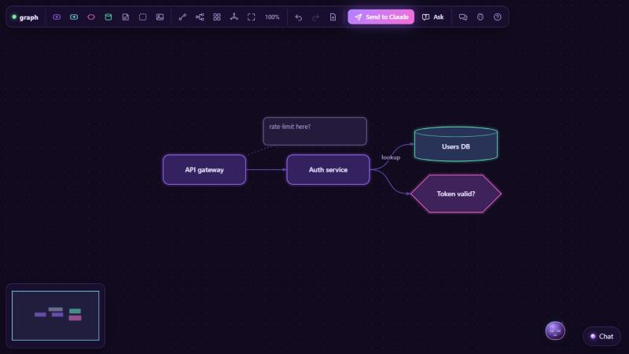

<p align="center">
  
</p>

<h1 align="center">lets</h1>

<p align="center"><b>Talk to Claude through windows, not just text.</b><br>
<code>/lets graph</code> opens a dark-violet board where you draw the thing you mean while you chat — and a small, bright companion flies beside your cursor, suggests, learns you, and teaches itself new tricks.</p>

---

<p align="center">
  
  <br><sub>The graph board after a short back-and-forth: two nodes drawn by hand, the rest added by Claude (a data node, a decision, an annotation, a tree layout).</sub>
</p>

## What it is

`lets` is a Claude Code plugin with three layers:

| Layer | What it does |
|---|---|
| **Engine** (`engine/`) | A zero-dependency Node MCP server. Hosts windows on loopback, carries the protocol, keeps the companion's memory, routes multi-task work to the cheapest trustworthy model, installs community mediums from git. |
| **Uniques** (`uniques/`) | The interactive mediums. Static web apps that speak LIP. First one: **graph**. |
| **Shell + SDK** (`sdk/`) | What every unique gets for free: the companion entity, chat panel, runtime components (sliders, options, forms, image paste…), toasts, theme. |

Everything crosses **LIP** — the *Lets Interaction Protocol* ([protocol/LIP.md](protocol/LIP.md)): typed JSON envelopes, up (human → Claude) and down (Claude → window). It is designed for mediums that do not exist yet; a unique for voice, AR or a haptic strip speaks the same envelope.

## Install (private, for now)

One command from a checkout (needs Node 18+, the `claude` CLI on PATH, and git credentials that can read the private repo: `gh auth setup-git`):

```bash
git clone https://github.com/TikoTikTok/lets.git && cd lets
node install.mjs
```

It adds the `lets` marketplace from GitHub, installs the `lets` plugin at user scope, and installs a personal `/lets` alias so both of these work in any session (restart the app or run `/reload-plugins` once):

```
/lets:lets graph
/lets graph
```

Options: `--local` (marketplace from this checkout instead of GitHub), `--native` (also the optional `lets-native` mod, Claude Code 2.1.287+), `--no-skill`, `--uninstall`.

By hand, inside Claude Code:

```
/plugin marketplace add TikoTikTok/lets
/plugin install lets@lets
```

and `node engine/bin/lets.mjs install-skill` for the bare `/lets` alias. Update later with `claude plugin update lets@lets`.

## Using it

1. `/lets graph plan the auth flow` — Claude opens the board in the app's browser pane, seeds a few nodes, and the companion greets you.
2. Draw. Double-click a node to rename, drag from a node's edge to connect, right-click to summon or dismiss the companion, click it for suggestions.
3. Press **Send to Claude** (or just keep chatting — window events reach Claude automatically with your next message).
4. Ask for more: *"open an image uploader"* → a paste/drop card appears; paste a screenshot and Claude reads the file. *"give me sliders for the weights"* → sliders appear, and every change reaches Claude.
5. `/lets entity` shows who the companion is and what it has learned; `/lets store timeline` searches the community store.

## Listening vs away

While `/lets graph` runs, Claude stays in an attentive loop and the window shows a green dot: everything you do in the window (chat, Ask, Send to Claude, Pip's menu, a pasted image) gets a reaction within seconds. When Claude is not in that loop the dot turns amber and the chat says *Pip is away*: your messages are kept and delivered with your next prompt in Claude Code. In the terminal CLI you can also load the plugin as a channel (`claude --dangerously-load-development-channels plugin:lets@lets`), and window events wake Claude directly.

## The companion

The entity is Claude's presence inside the window: a floating orb that follows your cursor with a gentle spring, flips sides so it never covers what you point at, and goes sleepy when you pause. It keeps a persona (`~/.lets/entity/persona.json`), an interaction profile learned from how you move and click, a memory of what you liked, and **special skills** — small markdown playbooks Claude writes for itself when it discovers a reusable way to help ("screenshot → nodes → questions"). Skills are listed on every open and read on demand, so the companion really does get better at *you*.

## Build your own unique

A unique is a folder:

```
my-unique/
  unique.json   # LIP manifest: name, entry, domains, capabilities, events, commands, permissions
  GUIDE.md      # how Claude should react to your events
  icon.svg
  ui/index.html # imports /sdk/lets-client.js and /sdk/lets-shell.js
```

Start from the template repo **lets-unique-template**, run the host standalone while developing:

```bash
node engine/bin/lets.mjs serve --open my-unique   # with my-unique in ./.lets/uniques/ or ~/.lets/uniques/
node engine/bin/lets.mjs validate ./my-unique
```

Publish by pushing to GitHub and adding an entry to a store (`lets-store`). Users install with `/lets store my-unique` → inspect → confirm. Uniques are static and sandboxed by CSP; the host never executes their code. See [docs/UNIQUES.md](docs/UNIQUES.md).

## Model routing

`/lets plan …` splits work into parallel waves and picks `haiku` / `sonnet` / `opus` per task from kind priors (format → haiku, architecture → opus …) and a ledger of past outcomes (`~/.lets/router/ledger.json`). Claude then spawns the waves with its Agent tool and reports back, so trust adjusts with evidence.

## Layout

```
.claude-plugin/   plugin + marketplace manifests
.mcp.json         registers the engine as MCP server "lets"
skills/lets/      the /lets skill (SKILL.md + reference.md)
hooks/            UserPromptSubmit hook: delivers window events with every prompt
engine/           host, bus, registry, entity, router, store, MCP server
sdk/              lets-client.js (transport), lets-shell.js/.css (companion, chat, components)
uniques/graph/    the first unique
protocol/         LIP.md + JSON schemas
docs/             architecture, authoring, entity
tests/            node --test
```

## Develop

```bash
npm test                                  # unit tests
node tests/mcp-smoke.mjs                  # full stdio ↔ host ↔ window round trip
node tests/hook-drain.mjs                 # the prompt hook against a live host
node engine/bin/lets.mjs serve --open graph --verbose     # standalone host, prints every event
node engine/bin/lets.mjs url graph                        # a window URL for the running host
node engine/bin/lets.mjs send graph.node.add '{"label":"Cache","kind":"data"}'   # play Claude by hand
node engine/bin/lets.mjs events                           # drain what the human did
claude plugin validate .
claude --plugin-dir .                     # try the plugin in a session
```

Tip for the app's browser pane: open the window URL once with its `#w=…&t=…` hash; a hash-only navigation does not reload the page, so after a host restart navigate elsewhere first.

State lives in `~/.lets/` (uploads, entity, router ledger, installed uniques, logs). Delete it to start fresh.

## License

MIT © TikoTikTok
